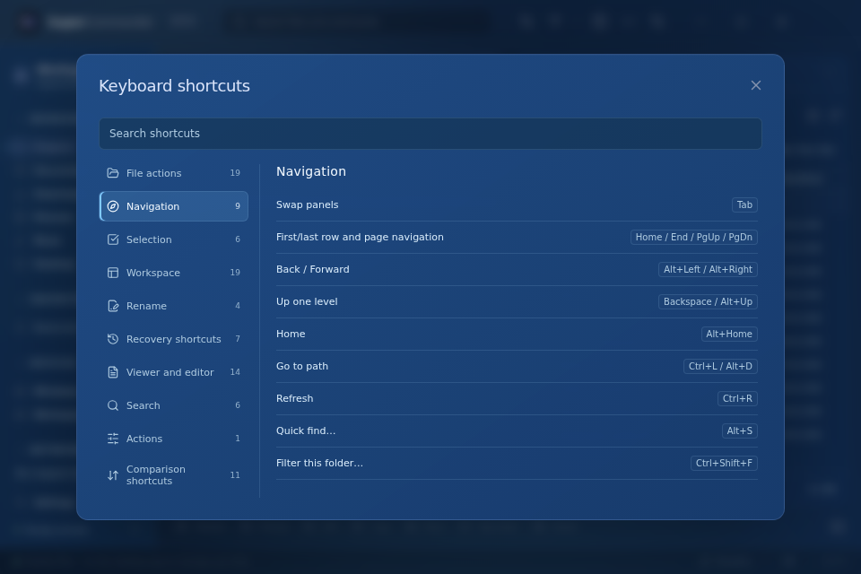
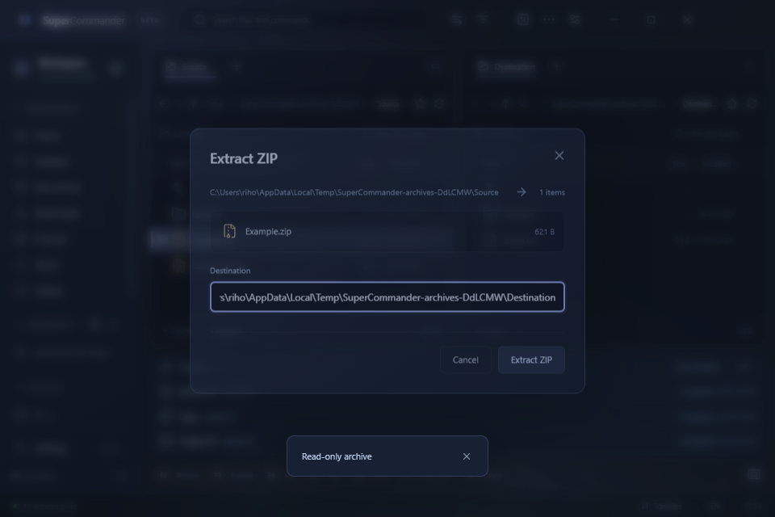
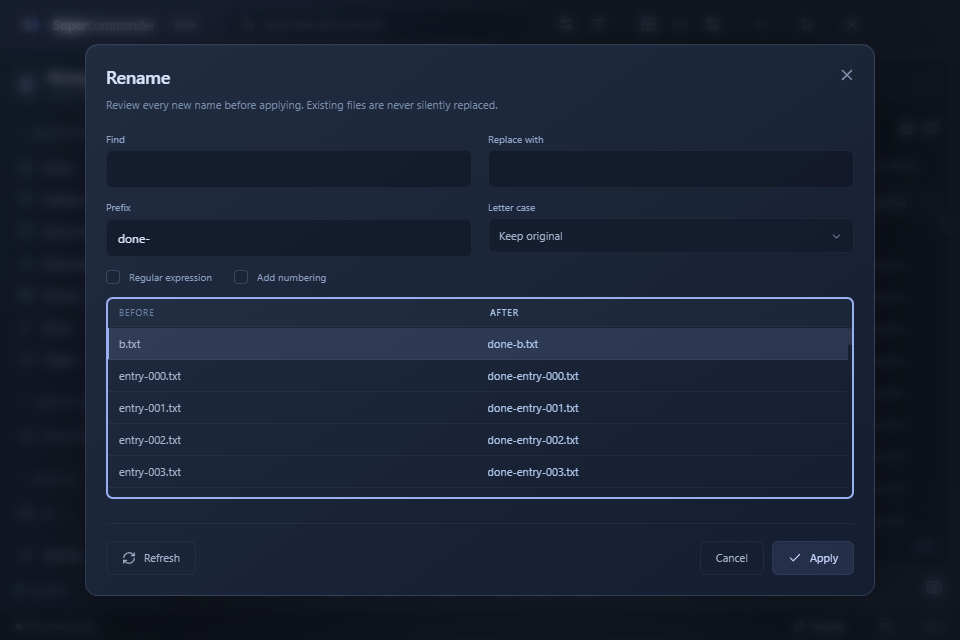
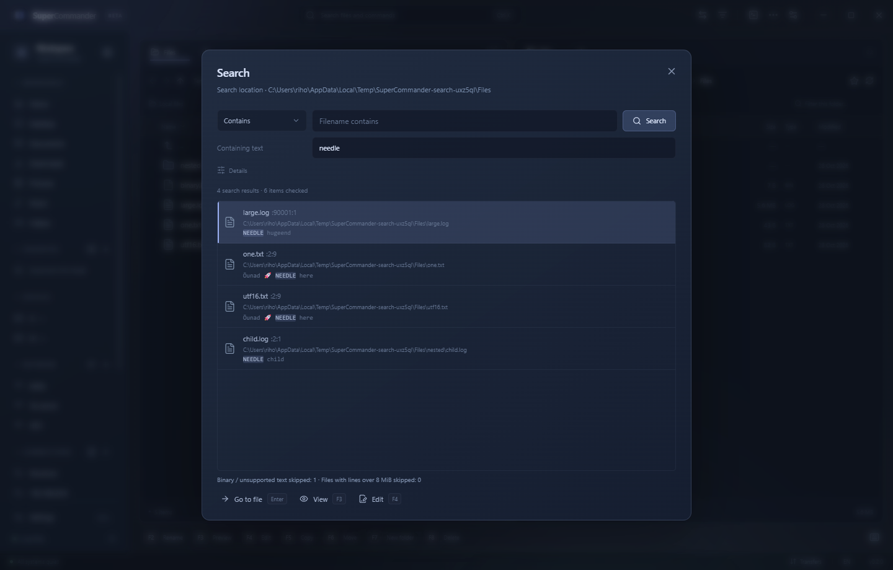
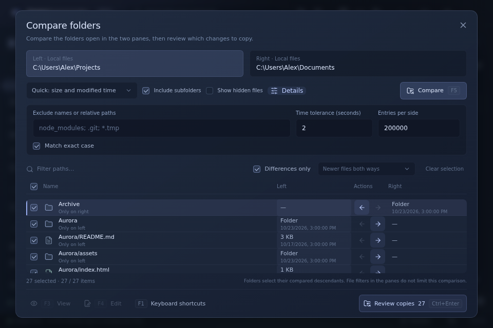
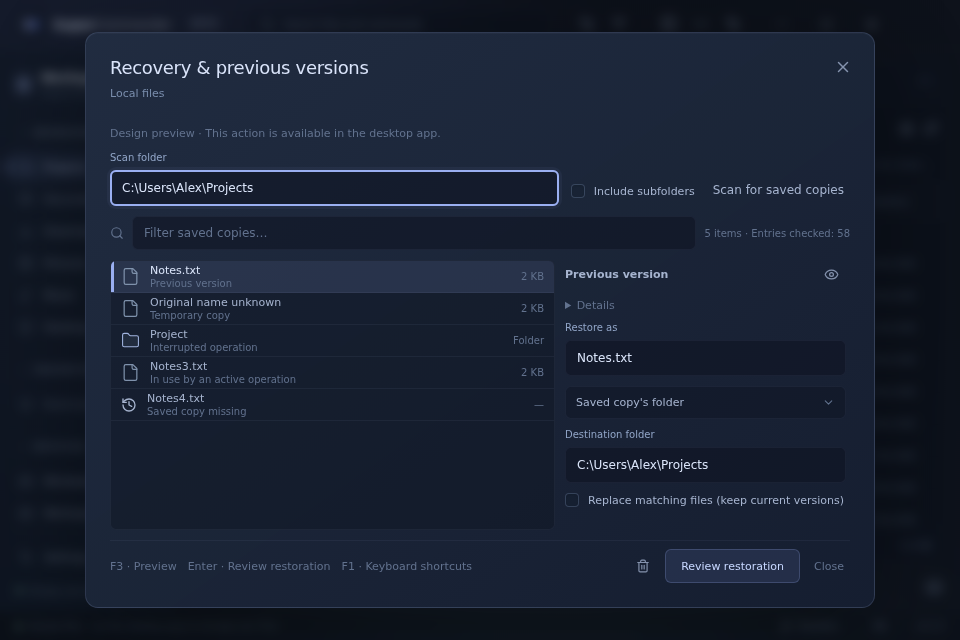
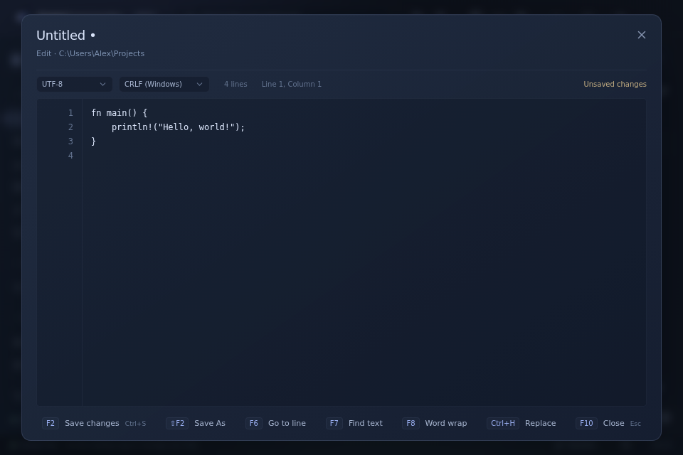
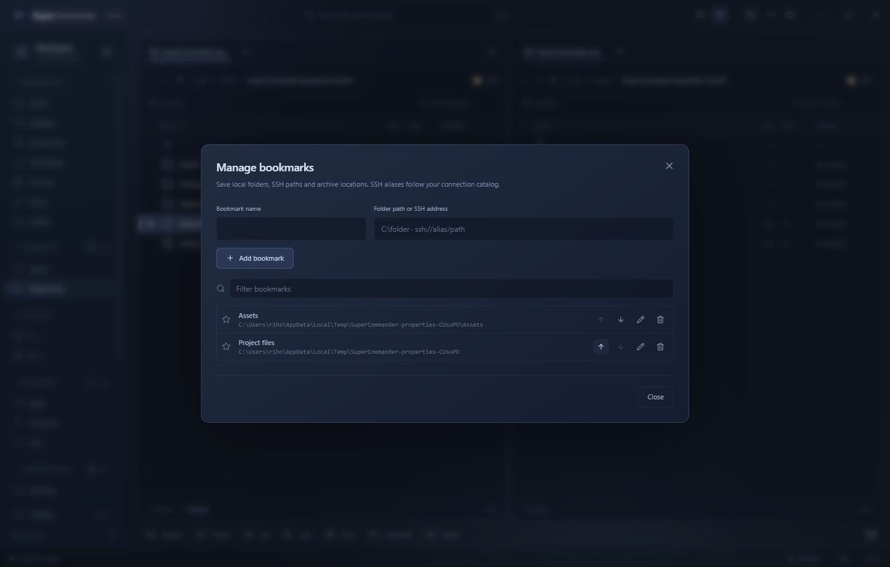
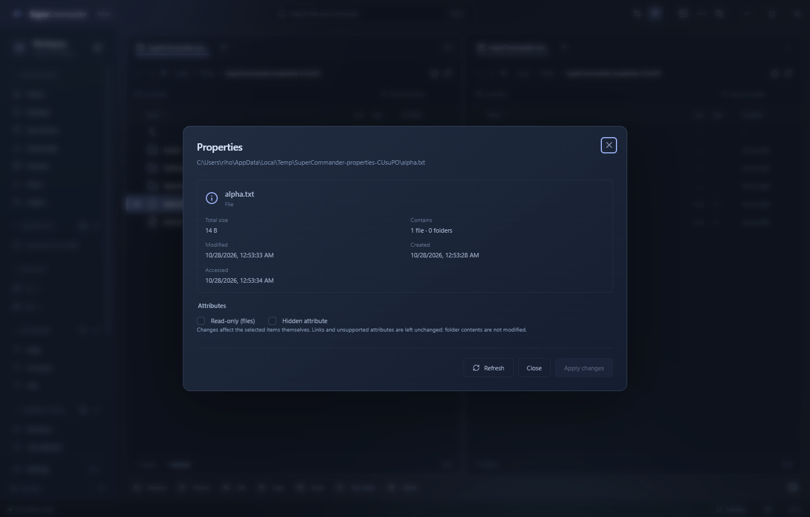

# SuperCommander

A modern dual-pane file manager for Windows, inspired by Midnight Commander. Built with a Rust core, Tauri 2, React and TypeScript, with a flat interface, subtle frosted glass, dark and light themes, and English and Estonian translations.

Browse local drives, UNC paths, ZIP archives and SSH/SFTP servers. Work with familiar keyboard shortcuts, edit files directly, open the server's shell, and keep SSH connections and port forwards in your existing OpenSSH config.

## Download

The latest release is **[SuperCommander 0.4.1](https://github.com/rihokirss/SuperCommander/releases/tag/v0.4.1)**.

Version 0.4.1 fixes clipped terminal rows and puts compact F-key buttons on the status bar. Version 0.4.0 adds faster startup, selectable blue and dark red palettes, a category-based F1 reference, next-match quick finding and folder sizes in the file list. It includes keyboard-accessible menus, bookmarks, file properties, native file clipboard support, quick editing, content search, reviewed folder synchronization, recovery of saved copies and safe ZIP operations.

- [Windows x64 installer](https://github.com/rihokirss/SuperCommander/releases/download/v0.4.1/SuperCommander_0.4.1_x64-setup.exe) — recommended.
- [Standalone Windows x64 executable](https://github.com/rihokirss/SuperCommander/releases/download/v0.4.1/SuperCommander_0.4.1_x64.exe) — requires WebView2.
- [SHA-256 checksums](https://github.com/rihokirss/SuperCommander/releases/download/v0.4.1/SHA256SUMS.txt).

## Screenshots

Dark theme with sample files. The keyboard cursor and marked files have separate highlights:


Light theme:


Compact port forwarding table, using a local test server:


## Run locally

Requirements: Node.js 24 LTS and stable Rust. On Windows, install Visual Studio C++ Build Tools with the Windows SDK and the WebView2 runtime.

```sh
npm ci
npm run tauri dev
```

For a browser-only design preview, run `npm run dev` and visit `http://127.0.0.1:1420`. This mode clearly labels its fictional sample files. Real file operations, SSH and terminals run in the desktop app.

Linux/WSL desktop development also needs:

```sh
sudo apt-get install build-essential pkg-config libgtk-3-dev libwebkit2gtk-4.1-dev librsvg2-dev libayatana-appindicator3-dev
```

## Build for Windows

On Windows:

```sh
npm run tauri build
```

The per-user NSIS installer is written to `target/release/bundle/nsis/`. It downloads WebView2 when needed. Builds are currently unsigned; automatic application updates are not implemented.

Cross-compile from WSL without installing Rust on Windows:

```sh
sudo apt-get install clang lld llvm nsis
rustup target add x86_64-pc-windows-msvc
cargo install --locked cargo-xwin
npm run build:windows
```

`cargo-xwin` downloads the Windows SDK and CRT. Outputs:

- `target/x86_64-pc-windows-msvc/release/supercommander.exe`
- `target/x86_64-pc-windows-msvc/release/bundle/nsis/SuperCommander_0.4.1_x64-setup.exe`

A successful cross-build does not replace testing the application on Windows.

See the [dependency review](docs/dependencies.md) for the 0.3.0 updates and remaining upstream security advisories.

## Keyboard and navigation

F1 opens a category sidebar with global search and keyboard navigation.



Each pane has independent tabs, history, sorting and filtering. Click its location bar to enter a local path, UNC path, SSH URL or SSH config alias. Click selects a file; Ctrl-click toggles a mark and Shift-click selects a range. Drag between panes to copy, or hold Shift to move. Dragging from Explorer copies into the destination pane.

| Shortcut | Action |
| --- | --- |
| Tab | Switch panes; dialogs keep normal field navigation |
| Arrows | Move the cursor without clearing marks |
| Insert | Toggle the current mark and advance to the next row |
| Space | Toggle the current mark without advancing |
| Ctrl+C / Ctrl+Insert | Copy selected files to the clipboard |
| Ctrl+X | Cut selected files to the clipboard |
| Ctrl+V / Shift+Insert | Paste files into the active pane |
| Ctrl+Shift+C | Copy full file paths (SSH URLs for remote files) |
| Ctrl+A / Ctrl+Shift+A | Select all / clear visible marks |
| Ctrl+I / * | Invert the visible selection |
| + / - | Select / deselect by filename pattern |
| Home / End | First / last row |
| Page Up / Page Down | Move by one visible page |
| Enter | Open the current file or folder |
| Ctrl+L / Alt+D | Edit the active pane's location |
| Ctrl+R | Refresh the active pane |
| Ctrl+Shift+R | Recovery and previous versions |
| Alt+S | Find the next matching filename without filtering the list; Enter / Alt+S advances, Esc closes |
| Ctrl+Shift+F | Focus the pane's filename filter |
| Alt+Up / Backspace | Parent folder |
| Alt+Home | Home directory of the current source |
| F2 | Rename, including bulk rename |
| F3 | View file |
| F4 | Quick edit, locally or over SFTP |
| Shift+F4 | New unsaved text file |
| F5 / F6 | Copy / move to the other pane |
| Alt+F5 / Alt+F6 | Create / extract ZIP |
| F7 | Create folder |
| F8 / Delete | Recycle; remote deletion is permanent and requires confirmation |
| Shift+F8 / Shift+Delete | Confirm permanent deletion |
| Ctrl+T / Ctrl+W | Open / close a pane tab |
| Ctrl+Tab / Ctrl+Shift+Tab | Next / previous tab in the active pane |
| Ctrl+Page Down / Ctrl+Page Up | Next / previous tab |
| Ctrl+Shift+T | Restore the last closed pane tab |
| Ctrl+D | Toggle the current local, SSH or ZIP folder's bookmark |
| Ctrl+Shift+D | Manage bookmarks: add, rename, reorder, filter or remove |
| Alt+Shift+Enter | Calculate marked folders, or all visible folders, in the Size column |
| Alt+Enter | Properties for marked items, the focused item or the current folder |
| Ctrl+U | Swap panes |
| Ctrl+H | Toggle hidden files |
| Ctrl+F | Search filenames and text contents |
| Shift+F2 | Compare the folders open in the two panes |
| Ctrl+K / Ctrl+P | Command palette |
| Ctrl+B | Collapse / expand Workspace |
| Ctrl+O | Full terminal / file panes, preserving the shell session |
| Ctrl+backtick | Show / hide the docked terminal |
| Ctrl+, | Settings |
| F1 | Searchable shortcut reference |
| F9 | Actions menu |
| Shift+F10 / Menu key | File context menu |

The `..` row opens the parent folder; at a ZIP root it returns to the archive's local parent. ZIP creation and extraction are available in the Actions menu. Double-click a ZIP to browse its read-only contents. Buttons expose tooltips with their shortcuts.

Right-click a file to act on that file or its existing multi-selection. Context menus use the clicked pane as their source. Menus support arrows, Home/End, type-ahead, Enter and Esc, and return focus to the originating control. Selection masks support `*` and `?`, work on the visible file list, and can include or exclude folders.

Refreshing the same directory preserves the filter, marked files and cursor when those files still exist. In the filter field, Enter or Arrow Down returns to the matching file list; Esc clears the filter and returns focus to the list.

File clipboard shortcuts work across local, SFTP and read-only ZIP sources, with writable destinations. Local files use the Windows shell file-drop format for interoperability with Explorer; remote and archive selections can be pasted within SuperCommander. Pasting a copy into its original folder creates a numbered duplicate. A cut is consumed after a successful queued move; skipped or partially processed sources remain available. A cut whose selected objects were replaced is cleared without removing those replacements. Esc cancels a pending cut without changing files. Text inputs and the terminal keep their own clipboard shortcuts.

SuperCommander records the selected roots when copying or cutting. Where the filesystem supplies stable IDs, replacing a selected file or folder before paste rejects the operation; in-place file edits and changes to a selected folder's children remain live until paste. Sources without IDs use stricter metadata checks, file checksums and folder membership checks, so changes may require copying the selection again. These bindings travel with the private clipboard format and are checked during queue inspection before any destination output. An incoming Explorer file-drop contains paths only and is checked from the time it is pasted.

Long clipboard checks show progress in the status bar and can be cancelled with **Esc** or the cancel button. Cancelling keeps the previous clipboard, and a newer clipboard selection prevents a slow check from publishing over it. A new Ctrl+C is available once an earlier paste has been handed to Transfers; late cut completion does not consume that newer copy. For unusually large folders on sources without IDs, use F5/F6 instead of the clipboard's bounded membership check.

SSH selections and queued operations stay bound to the authenticated connection they were created for. After disconnecting or reconnecting, copy the remote files again; an earlier job cannot silently use the replacement connection. Transfer checks resolve server paths before comparing aliases and reject copying a directory into itself through a symbolic link or `..`.

Transfers show **Checking source files** while recording the selected file versions and folder contents. This runs outside the UI thread and can be cancelled from Transfers. The queue keeps its original order during inspection. Before starting, it rechecks the selection's content, metadata and available filesystem identities; changed sources or replaced local destination folders require starting the operation again. Copy/move use the recorded file list, and copied bytes must match the recorded checksums. Large or remote selections require additional read time for these checks. Cancelling during inspection leaves destination files untouched.

### ZIP archives

**Alt+F5** creates a ZIP from the marked files or folder; **Alt+F6** extracts selected ZIPs to the other pane's local folder. Both actions are also in F9 and the command palette. Creation uses the active pane's local folder, including when the other pane is connected to SSH. Local drives and UNC paths are supported.

Double-click a ZIP to browse its read-only contents. The file list shows modification times, **F3** opens a file and **F5** copies selected entries out. The `..` row at the ZIP root returns to its local parent and focuses the archive. Navigating up from a folder focuses the folder just exited. Entries larger than 128 MiB require **Extract** rather than the ZIP browser; extraction streams their contents and supports ZIP64 files larger than 4 GiB.

Creation uses the queued file manifest, checksums the bytes being compressed and checks the sources again before publishing. A source replacement, changed contents or new folder children prevents the archive from replacing an existing destination. Extraction first makes and validates private copies of all selected ZIP containers, so replacing an input during extraction cannot change its entry names or contents. The private copies require temporary disk space for the compressed inputs.

ZIP metadata preserves modification times to the format's available precision, including UTC extra fields and NTFS timestamps at 100 ns resolution. DOS-only timestamps are interpreted as local time. Unix permission bits and Windows file read-only state are preserved; newly created folders receive their metadata after their contents. Existing folder permissions remain unchanged. Ownership, ACLs, alternate streams and Windows hidden flags are not stored in ZIP metadata.

Existing files require a conflict decision. Replaced versions remain available with recovery records in Transfers. Selected source files and their physical aliases cannot be overwritten by the archive's output. Invalid paths, links, special files, duplicate targets, ambiguous case spelling and file/folder collisions are rejected before extraction creates output. Parent directories are checked again before publication. Cancellation cleans the current temporary file; earlier extracted files remain available, and cleanup errors identify temporary output that may need recovery.

Creation and extraction support up to 200,000 file/folder paths and 256 path components. Stored and Deflate ZIPs are supported. Password-protected ZIPs and 7z/RAR archives are not supported.



### Rename

**F2** renames one file or opens a bulk preview with find/replace, regular expressions, case conversion, prefixes and numbering. Review the before/after names, then press **Enter / Ctrl+Enter** to apply. The compact preview supports arrows, Home/End and Page Up/Down without mounting every row. **F1** opens shortcut help; **F5 / Ctrl+R** refreshes a stale review. **Esc** closes the dialog and cancels pending checking or renaming.

Confirmation uses the reviewed server-side plan and its original SSH session. Native file IDs reject replacement objects while allowing edits to the same file and changes within a selected folder. Backends without IDs use stricter metadata, file checksum and folder membership checks. Renaming an explicitly selected folder together with its children is rejected. Case-only changes work on Windows, and an existing distinct destination is never replaced.

Each changed name uses a private claim and a recovery record. If a batch fails, SuperCommander attempts to restore completed names without overwriting files that appeared in the meantime or moving replacement objects. If a name cannot be restored, the error identifies the remaining paths. Interrupted private claims can be found in **Recovery & previous versions**. Rename checking accepts up to 100,000 selected roots; fallback membership and case-spelling checks have bounded directory listings.



### Search

**Ctrl+F** searches the active location, including subfolders by default. Match part of a name, use semicolon-separated wildcard masks such as `*.rs;*.toml`, or choose a filename regular expression. Optional content search reads UTF-8 and BOM-marked UTF-16 text, with case and whole-word options and per-line regular expressions. Each matching file appears once, with its first matching line, column and highlighted excerpt.

Details include excluded names/relative paths, recursion, hidden items, file/folder type, size/date ranges and a result limit (20,000 by default; up to 100,000). Size ranges and content filters apply to files. Child symbolic links and junctions are not traversed; known special files are refused. Stopped searches keep their partial results. Errors, binary/unsupported text and files with lines over 8 MiB are reported separately.

Navigate results with arrows, Home/End or Page Up/Down. **Enter** opens the containing folder and marks the file; **Ctrl+Enter** uses the other pane. **F3/F4** open the viewer/editor at the matching position and return to the retained results when closed. **F1** opens the shortcut reference. Results from a replaced SSH connection require a new search before opening.



### Folder comparison and synchronization

**Shift+F2** compares the folders open in the two panes, including local, UNC, SSH and read-only ZIP locations. The default content comparison uses SHA-256 for binary as well as text files; quick comparison uses size and modified time. Choose recursion, hidden files, case matching, semicolon-separated exclusions, timestamp tolerance and an entry limit. Pane filename filters do not narrow the comparison.

Review differences, filter their relative paths with **Ctrl+F**, and choose each copy direction with **Alt+Left / Alt+Right**. Folder selections include their compared descendants. The default policy copies missing and newer files both ways; differences with equal timestamps require an explicit choice. **Insert** toggles a choice and advances, **Space** toggles without advancing, and **Ctrl+A / Ctrl+Shift+A** select or clear the visible differences. **F3/F4** view or edit a file on the side chosen with Left/Right; closing returns to the comparison. Saving invalidates the comparison.

**Ctrl+Enter** opens a review of every selected path, its direction and the create/replace counts; press it again to queue those copies. Synchronization does not delete files. Replacements keep their previous versions beside the destination, with recovery records listing the original paths; expand **Previous versions** in Transfers for their locations. These copies are retained until you remove them yourself. Source contents, destinations and SSH sessions are checked again before copying, including after a wait in the queue. Changed files, new conflicting destinations, replaced connections, incomplete scans and entry-limited results require a new comparison. Symlinks, junctions, ambiguous case matches and file/folder conflicts remain blocked for review.



### Recovery and previous versions

Press **Ctrl+Shift+R**, or choose **Recovery & previous versions** from F9 or the command palette. Scan the active folder for saved copies and recovery records, including hidden files; enable **Include subfolders** to search deeper. The view supports local/UNC and connected SSH folders. Windows Recycle Bin recovery remains in the Recycle Bin.

Select a saved copy with the arrows, Home/End or Page Up/Down. **Ctrl+F** filters names; **F3** opens a read-only file view or reveals a preserved folder. **Enter / Ctrl+Enter** prepares a restoration: choose a name and destination, optionally select the other pane's folder, then review every path and its create/replace action. **Ctrl+Enter** in the review queues the copies. Conflicting existing files require explicit replacement; their current versions are retained as previous versions. Restoration keeps the saved copy and its record, including when copying from SSH to a local folder.

Expand **Previous versions** in Transfers to open recovery at the corresponding destination. **F5 / Ctrl+R** rescans after a transfer finishes. Copies being used by a current operation cannot be restored or removed. A changed file, record, destination or SSH session requires a new review. A checksum mismatch can be copied under a new name without replacement. Temporary files without records may contain only partial data; inspect their contents first.

**Delete** asks before permanently removing the selected saved copy and its record. If removal fails, the record remains available. An interrupted directory operation may leave nested recovery records inside the remaining tree: restore the folder, then scan that restored folder to recover individual names. Permanent deletion cannot recover files already removed before cancellation or a process exit.

Restoration planning streams directory entries and reserves one shared budget across pending siblings and descendants. Trees larger than 200,000 entries require restoring smaller subfolders separately; cancellation also stops directory enumeration before the entire listing is collected.

Recovery view with fictional sample data (restoration is enabled in the desktop app):



### Viewer and quick editor

Text files open in a spacious viewer with line numbers, search and optional word wrap. Image and PDF previews are also available. F4 opens the built-in editor; ZIP contents remain read-only.

Shift+F4 starts an unsaved new text file in the active pane. Save As supports local folders and connected SSH servers, with UTF-8, UTF-8 BOM, UTF-16 LE/BE and LF/CRLF options. Existing destinations require confirmation; changes made by another application during that confirmation are preserved. An SSH editor can also save a local copy without changing its remote original.



| Shortcut | In the viewer or editor |
| --- | --- |
| F2 / Ctrl+S | Save in the editor |
| Shift+F2 / Ctrl+Shift+S | Save As |
| F1 | Editor and viewer shortcut reference |
| F4 | Switch from viewer to editor |
| F6 | Go to line |
| Ctrl+Page Up / Ctrl+Page Down | Previous / next text page in the viewer |
| F7 / Ctrl+F | Find text |
| Ctrl+G / Shift+F7 | Next / previous match |
| F8 | Toggle word wrap |
| Ctrl+H | Find and replace in the editor |
| Ctrl+Z / Ctrl+Y | Undo / redo |
| Ctrl+C / Ctrl+V | Copy / paste |
| Tab / Shift+Tab | Insert a tab, or indent / unindent selected lines |
| F10 / Esc / Ctrl+W | Close the viewer or editor |

The editor supports local and SFTP text files up to 4 MiB. It preserves UTF-8/UTF-16 encoding, BOM and LF/CRLF line endings, stages replacements in a temporary file, and rejects saves if the original content changed externally. Binary files, unsupported encodings, mixed line endings and symbolic links are not editable.

The text viewer reads bounded pages of about 256 KiB or 2,000 lines, preserving complete lines up to 8 MiB each. **Ctrl+Page Up/Down** loads the previous/next part and **F6** jumps to a file line. This also lets content-search results open beyond the editor's size limit.

**F7 / Ctrl+F** finds literal, case-insensitive text throughout the file, including pages not yet loaded. Enter or **Ctrl+G** finds the next match; Shift+Enter, **Shift+F7** or **Ctrl+Shift+G** finds the previous one. Search wraps at the beginning/end and reports when no matches exist. The query and word-wrap choice survive page changes. Searches use bounded memory with UTF-8 or BOM-marked UTF-16 input; lines over 8 MiB and unsupported encodings produce an explicit error. Changing the query, closing the search bar or closing the viewer cancels its pending search. An open SSH viewer remains bound to its original connection, including when switching to the editor.

Closing a modified editor or the application window offers Save, Discard and Cancel. Save completes before closing; a failed save leaves the edits available. Esc in Save As or an overwrite confirmation closes that inner dialog. No file is created for a new buffer until it is saved.

### Workspace and appearance

Bookmarks can point to local/UNC folders, SSH addresses or folders inside ZIP archives. SSH catalog connections are saved by their Host alias, so later config changes apply to the bookmark too. Use **Ctrl+D** to toggle the current location or **Ctrl+Shift+D** to manage bookmarks. On a sidebar bookmark, **F2** edits it, **Delete** removes the bookmark, and **Ctrl+Enter** opens it in the other pane. Removing a bookmark leaves the files untouched.



UNC bookmarks preserve folder-path case, so differently cased locations on case-sensitive shares such as WSL remain separate.

**Alt+Enter** opens file properties, also available from the file context menu. Inspect sizes, timestamps, Windows flags, SSH owner/group IDs and link targets. Read-only and hidden flags are editable where Windows supports them; SSH permissions support octal input and owner/group/other checkboxes. Mixed selections show indeterminate values and preserve permission bits that you do not change. Attribute changes affect the selected items themselves; they do not recurse into folders. A changed file or replacement SSH connection requires refreshing before applying.

Folder sizes are calculated on request, with progress, cancellation and partial-error reporting. These are apparent file sizes, rather than allocated disk space. Overlapping selected roots are deduplicated; symbolic links and Windows junctions are counted without traversing their targets. ZIP properties are read-only.



Workspace collapses into an icon rail. Each section can also be collapsed independently; these choices persist. **Network** includes network folders and servers from Explorer Quick Access, mapped drives and saved Windows network shortcuts. Its refresh button reloads them. Use **+** to add a UNC location, rename a listed entry, remove it from SuperCommander or restore a removed Explorer entry. These customizations are saved in SuperCommander and leave Explorer's pins unchanged. Opening a server such as `\\server` lists its shared folders through the Windows shell; the `..` row at a share root returns to the server. UNC paths can also be entered directly; the app does not scan the network for devices.

Settings offer dark, light or Windows-following modes and separate palette choices: Midnight blue, Midnight with classic blue (#173E76), graphite with blue panels, and corresponding three dark red palettes for dark mode, and Sky blue, Ice blue and Azure for light mode. Choices preview immediately, persist independently and apply to menus, dialogs and native glass. The titlebar sun/moon button switches modes while keeping each palette; using it replaces the Windows-following mode with an explicit choice. Settings offer a glass toggle and a transparency slider. Compact mode uses 26 px rows for both files and Workspace; Comfortable uses 34 px. Transfers use dense rows, expanding details only when needed. Select menus, checkboxes and switches follow the app's theme.

## SSH connections and port forwarding

The connection catalog uses `%USERPROFILE%/.ssh/config` as its source of truth. The file button beside **Connections** opens its editor; you can choose another config file, including a WSL file through a UNC path.

**Save connection** adds or updates `HostName`, `User`, `Port` and `IdentityFile` in the corresponding `Host` block. **Connect** can open a session without saving. New profiles are not duplicated in application settings. Legacy application profiles remain readable and migrate to SSH config when saved from the connection form.

Supported address examples:

```text
sftp://user@server:2222/path
ssh://user@server/path
user@server:/path
ssh://my-config-alias/path
```

Select a saved connection in the sidebar to connect immediately using its configured key, agent or saved secret. If authentication or connection fails, the prefilled form opens with the error; an unknown or changed server key still requires explicit confirmation. SSH locations open as SFTP in the requested pane. Both panes can reuse an open connection. Different servers or users authenticate separately. Verify the server's SHA-256 fingerprint before trusting it. Remembered passwords and key passphrases use Windows Credential Manager, not the settings file.

The catalog resolves concrete aliases, Host patterns, first-value-wins defaults, Include files, usernames, ports and identity files. With no explicit key, authentication tries the Windows OpenSSH agent and default key files. Comments and other options are preserved. Saving creates a backup and checks for external config changes.

`Match`, `ProxyJump` and `ProxyCommand` are preserved but not executed; affected connections are marked unsupported. Shared multi-alias blocks and aliases defined in included files can be edited in the config text editor.

### Server shells

The terminal follows the active pane when opened. Local panes use PowerShell 7, falling back to Windows PowerShell. SSH panes open the server's interactive shell with a PTY through the existing authenticated SSH connection. Local and per-server shell sessions remain separate and survive Ctrl+O toggling. Drag the docked terminal’s top edge or use the focused separator’s Up/Down keys to change its height; the choice is remembered. Closing a shell leaves SFTP connected; disconnecting SSH closes its shells and tunnels.

A remote shell starts in the server's default home directory. Pane navigation does not inject commands into an existing shell. If a server denies a shell or PTY, the error is shown.

### Remembered port forwards

Open **Actions → Port forwarding** from an SSH pane. Add multiple tunnels to the same connection. The compact table shows local addresses, destinations, status and whether each port is remembered. Each row supports copying its address, starting/stopping and removing the forward.

Listeners bind to `127.0.0.1` only. Local port `0` selects a free port. **Remember** writes a `LocalForward` directive with the actual local port into the connection's SSH config block. Remembered ports reopen automatically on the next connection. Stopping preserves the saved entry; removing deletes it. Binding and tunnel errors are displayed, and disconnecting closes active tunnels.

Inherited or shared forwarding directives can be changed in the config text editor. Unsupported bindings are preserved in the file and are not opened by the app.

## Data and operation behavior

Local panes and settings load first at startup. Explorer network locations load in the background; their loading or failure does not block the file panes. Drive letters are enumerated without probing mapped shares.

Settings, pane tabs, bookmarks and trusted fingerprints are stored in `%APPDATA%/SuperCommander/settings.json`, with a backup of the previous settings. Secrets are stored separately in Windows Credential Manager.

File operations run in a queue. Copy/move directory listings are captured in a private disk-backed manifest before output starts, so an alias cannot cause recursive copying of newly created output. Copies are staged in temporary `.part` files. Replacements check the destination's metadata and contents, preserve its original in a backup, and publish without overwriting a concurrently created file.

Sources are checked against the copied contents before publication. Moves delete only their privately claimed source file. They never recursively remove a source tree: completed files move individually, skipped/unprocessed files stay at their source, and only empty source directories are removed. Cross-source directory moves also check for aliases and descendants before writing. Cancellation is remembered even if it arrives before enqueue; it cleans up the current partial copy and restores its claimed source, while already completed files stay at their destination. A failed restoration preserves the original and reports its exact path in the queue's **Details**.

Before temporarily renaming any original, the app writes a sibling `.recovery.json` record containing its original path, saved path and available checksum. Normal completion or rollback removes transient records; retained previous versions keep theirs. After an unexpected process exit, use **Ctrl+Shift+R** to scan the affected folder. Recovery resolves payloads beside their records rather than following an arbitrary absolute path in a record, so a saved tree can also be inspected through another path namespace.

Copies preserve modification times and supported permissions; newly created directories receive their source metadata after their contents finish. Copy/move staging files and recovery records start with owner-only POSIX permissions on Unix/SFTP backends; Windows uses the destination directory's ACL. Windows copies also preserve hidden/read-only flags. Protected Windows sources must have their read-only attribute cleared before moving, and read-only destinations are not replaced. Ownership, ACLs and alternate data streams are not cloned.

Permanent deletion uses the captured selection and privately claims each file or directory before removing it. It unlinks checked files and removes only empty directories, rather than handing a live tree to recursive removal. Cancellation and errors restore the remaining claimed data where possible; already deleted files stay deleted. Newly appeared children stop directory cleanup. A disconnected destination in the other pane does not prevent deletion from the active source.

Recursive searches and copies do not follow symbolic links or Windows junctions. ZIP extraction validates paths and prevents escapes through symbolic links. Extract an archive instead of copying an individual file larger than 128 MiB from the ZIP browser.

Current archive operations support local ZIP files. Server-to-server direct transfers, a remote recycle bin and 7z/RAR are not implemented; SFTP transfers pass through the client. Folder synchronization copies explicitly reviewed differences without automatic deletion.

## Tests

```sh
npm test
npx playwright install chromium
npm run test:ui
npm run build
cargo test -p commander-core
cargo test -p commander-core streams_one_hundred -- --ignored
```

Playwright covers independent panes, navigation, selection, shortcuts, dialogs, themes, settings persistence and layouts from 960 to 1920 px. Rust tests use real temporary files for transfers, cancellation, conflicts, ZIP handling, previews, renaming, editor encoding and concurrent-change detection, and SSH config preservation. Transfer regressions include physical aliases through different source IDs, same-size/same-time external edits, failed restoration, source files created during a move, interrupted child processes and recovery records. `scripts/windows-transfer-smoke.mjs` tests native Windows moves and attributes; with the temporary loopback fixture, it also checks actual UNC ↔ SFTP aliases and directory moves in both directions.

For a real OpenSSH integration test on WSL, install `openssh-server` and `ssh-keygen`, then run:

```sh
cargo test -p commander-core --test sftp -- --ignored --nocapture
```

The test starts an isolated loopback server with temporary keys and verifies host keys, key authentication, wrong credentials, file transfers, tunnels, an interactive shell and disconnection behavior.

### Native Windows smoke test

Run `node scripts/windows-smoke.mjs [path-to-supercommander.exe]` with **Windows Node**. It launches an owned test process on port 9224 with separate settings and WebView data, exercises real Rust IPC, file operations, editor saves, previews, the recycle bin and PowerShell/ConPTY, and removes its own process and temporary files afterward. It refuses to attach to an existing debugging endpoint. The default executable is `target/release/supercommander.exe`. Use `SC_SCREENSHOT` to choose the final diagnostic screenshot path.

To include SSH UI checks, first run `node scripts/sftp-fixture.mjs` in WSL. This creates a temporary loopback SSH server and test keys. The Windows smoke test edits only a temporary SSH config, transfers files both ways, edits a remote file, exercises the server shell, and saves and reopens multiple forwards. It closes its own SSH sessions afterward. Stop the fixture with Ctrl+C to remove its keys and files.

Generate public design screenshots from the running Vite preview with `node scripts/screenshots.mjs`. Only fictional sample data is used. The native Windows smoke test captures the forwarding dialog against its local test server.

The Windows GitHub Actions workflow runs checks and produces an x64 executable and NSIS installer as build artifacts. Publishing releases and signing builds are not automatic.

The workflow also runs native file-clipboard tests in its dedicated Windows desktop, including shell file-drop formats, an external clipboard producer/consumer, Unicode, copy/cut/paste, duplicate folders and conditional clipboard cleanup. `scripts/windows-clipboard-smoke.mjs` requires `CI=true` and launches its own built executable on debugging port 9224; it owns that test desktop's clipboard and must not run on a user's desktop.

`node scripts/windows-network-smoke.mjs [path-to-supercommander.exe]`, run with Windows Node, checks Explorer imports, adding and persisting a custom UNC location, renaming/removing it, the collapsed sidebar tooltip, and browsing a server root through the Windows shell. It launches its own isolated app and uses an owned temporary folder through the WSL Ubuntu share.

Source: [rihokirss/SuperCommander](https://github.com/rihokirss/SuperCommander).

`node scripts/windows-properties-smoke.mjs [path-to-supercommander.exe]`, run with Windows Node, checks real Windows read-only/hidden changes, stale metadata protection, mixed selections, folder sizes and junction handling, persistent local/ZIP bookmarks and one collapsed sidebar tooltip. With the SFTP fixture running, it also checks SSH permissions, direct-connection reuse and alias bookmarks after reload. It launches and closes its own test app on port 9224 with temporary settings and a separate WebView profile. The default executable is `target/release/supercommander.exe`; pass the executable path when testing a cross-build. The Windows workflow runs this test after the native clipboard test.

`SUPERCOMMANDER_DATA_DIR` can override the application settings directory with an absolute path. Tests use it to keep their settings and backups separate from your working profile. The default remains the per-user SuperCommander configuration directory. SSH config files and Credential Manager credentials retain their existing locations.

`node scripts/windows-search-smoke.mjs [path-to-supercommander.exe]` owns an isolated test instance and checks content search, Unicode positions, UTF-16 viewing, retaining results through F3/F4, large-file paging, F6 and focusing a file in its containing pane. With the temporary SFTP fixture it also tests remote content search/editing, connection replacement protection and refreshing pane metadata after a save. The Windows workflow runs the local cases.

`node scripts/windows-editor-smoke.mjs [path-to-supercommander.exe]`, run with Windows Node, launches its own isolated test app and tests new files, Save As, encoding conversions, overwrite conflicts, and native window close protection. The Save & Close assertion closes only that test window. Run native test scripts sequentially; they reserve port 9224.

`node scripts/windows-recovery-smoke.mjs [path-to-supercommander.exe]` owns an isolated Windows app and verifies discovery, read-only viewing, previous-version links in Transfers, file/folder restoration, complete virtualized review, empty folders, orphan copies, record cleanup and stale reviews. With the WSL SFTP fixture it also verifies remote records written through UNC, SSH-to-local recovery, cross-protocol directory aliases and replaced sessions. `windows-terminal-resize-smoke.mjs` checks a real PowerShell resize, session continuity and saved height. With the WSL fixture, `windows-ssh-autoconnect-smoke.mjs` checks direct connections, failures and host-key confirmation. `windows-tooltip-smoke.mjs` checks collapsed workspace hints in WebView2, including native HTML/SVG hints appearing after hover.

`node scripts/windows-rename-smoke.mjs [path-to-supercommander.exe]` owns an isolated Windows app and checks reviewed source replacement, refreshing after failure, case-only changes, cancellation before worker registration, a complete virtualized bulk review, keyboard help and compact dark/light layouts. It observes actual delayed IPC requests when checking pending-preview and pending-apply behavior. With the WSL SFTP fixture it also verifies remote renaming and rejection after reconnecting. It does not use the desktop clipboard.

`node scripts/windows-archive-smoke.mjs [path-to-supercommander.exe]` checks the native ZIP shortcuts, browsing/F3, exact modification times, empty directories, Windows read-only state, retained previous versions, hard-link source aliases, early cancellation and junction protection. It owns its app and temporary files and does not use the desktop clipboard. The larger `cargo test -p commander-core --test archives zip64_round_trip_extracts_an_entry_larger_than_four_gibibytes -- --ignored --nocapture` acceptance test creates a sparse input above 4 GiB and extracts its full contents; run it separately with enough disk space.

`node scripts/windows-startup-smoke.mjs [path-to-supercommander.exe]` verifies that both file panes remain usable while the real Explorer discovery request is held, then lets discovery complete and reports startup IPC timings. It uses an isolated Windows app and settings.

Choose **Calculate folder sizes** from F9 / Actions or press **Alt+Shift+Enter**. Marked folders are calculated when present; otherwise all visible folders are scanned. Results appear in the Size column and can be sorted. Scans do not follow symbolic links or junctions. Partial results have a ≥ prefix and error details in their tooltip; cancel from the pane footer. Refreshing or changing location clears calculated values and cancels the scan.

**F1** opens a category sidebar with global shortcut search and keyboard navigation. Contextual help opens the relevant category. Opening a folder focuses its first row, normally `..`; at a drive root the first entry is focused.
