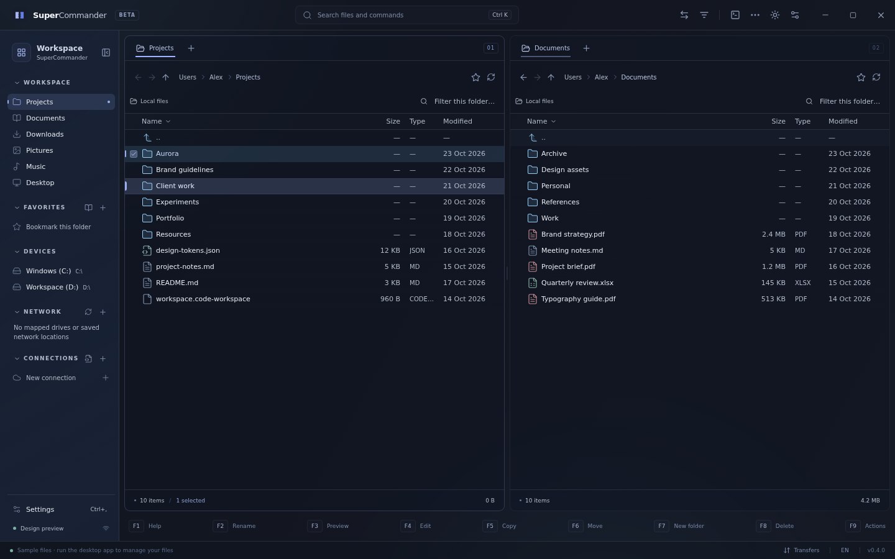
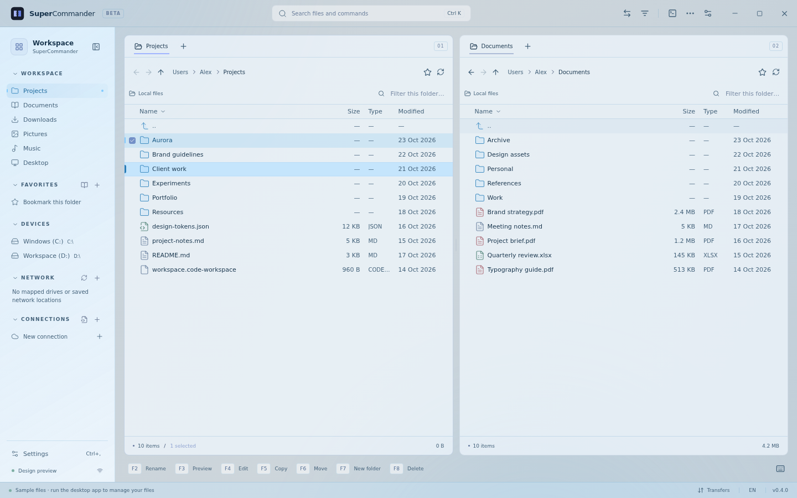
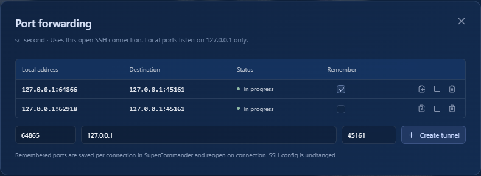

# SuperCommander

A modern dual-pane file manager for Windows, inspired by Midnight Commander. Built with a Rust core, Tauri 2, React and TypeScript, with a flat interface, subtle frosted glass, dark and light themes, and English and Estonian translations.

Browse local drives, UNC paths, ZIP archives and SSH/SFTP servers. Work with familiar keyboard shortcuts, edit files directly, open the server's shell, and keep SSH connections and port forwards in your existing OpenSSH config.

## Download

The first public release is **[SuperCommander 0.2.0](https://github.com/rihokirss/SuperCommander/releases/tag/v0.2.0)**.

The `main` branch contains ongoing improvements beyond that release, including keyboard-accessible menus, file context actions, wildcard selection and searchable shortcut help. The shortcuts below describe the current source.

- [Windows x64 installer](https://github.com/rihokirss/SuperCommander/releases/download/v0.2.0/SuperCommander_0.2.0_x64-setup.exe) — recommended.
- [Standalone Windows x64 executable](https://github.com/rihokirss/SuperCommander/releases/download/v0.2.0/SuperCommander_0.2.0_x64.exe) — requires WebView2.
- [SHA-256 checksums](https://github.com/rihokirss/SuperCommander/releases/download/v0.2.0/SHA256SUMS.txt).

## Screenshots

Dark theme with sample files. The keyboard cursor and marked files have separate highlights:



Light theme:



Compact port forwarding table, using a local test server:



## Run locally

Requirements: Node.js 24 LTS and stable Rust. On Windows, install Visual Studio C++ Build Tools with the Windows SDK and the WebView2 runtime.

```sh
npm ci
npm run tauri dev
```

For a browser-only design preview, run `npm run dev` and visit `http://127.0.0.1:1420`. This mode clearly labels its fictional sample files. Real file operations, SSH and terminals run in the desktop app.

Linux/WSL desktop development also needs:

```sh
sudo apt-get install build-essential pkg-config libgtk-3-dev libwebkit2gtk-4.1-dev librsvg2-dev libayatana-appindicator3-dev
```

## Build for Windows

On Windows:

```sh
npm run tauri build
```

The per-user NSIS installer is written to `target/release/bundle/nsis/`. It downloads WebView2 when needed. Builds are currently unsigned; automatic application updates are not implemented.

Cross-compile from WSL without installing Rust on Windows:

```sh
sudo apt-get install clang lld llvm nsis
rustup target add x86_64-pc-windows-msvc
cargo install --locked cargo-xwin
npm run build:windows
```

`cargo-xwin` downloads the Windows SDK and CRT. Outputs:

- `target/x86_64-pc-windows-msvc/release/supercommander.exe`
- `target/x86_64-pc-windows-msvc/release/bundle/nsis/SuperCommander_0.2.0_x64-setup.exe`

A successful cross-build does not replace testing the application on Windows.

## Keyboard and navigation

Each pane has independent tabs, history, sorting and filtering. Click its location bar to enter a local path, UNC path, SSH URL or SSH config alias. Click selects a file; Ctrl-click toggles a mark and Shift-click selects a range. Drag between panes to copy, or hold Shift to move. Dragging from Explorer copies into the destination pane.

| Shortcut | Action |
| --- | --- |
| Tab | Switch panes; dialogs keep normal field navigation |
| Arrows | Move the cursor without clearing marks |
| Insert | Toggle the current mark and advance to the next row |
| Space | Toggle the current mark without advancing |
| Ctrl+C / Ctrl+Insert | Copy selected files to the clipboard |
| Ctrl+X | Cut selected files to the clipboard |
| Ctrl+V / Shift+Insert | Paste files into the active pane |
| Ctrl+Shift+C | Copy full file paths (SSH URLs for remote files) |
| Ctrl+A / Ctrl+Shift+A | Select all / clear visible marks |
| Ctrl+I / * | Invert the visible selection |
| + / - | Select / deselect by filename pattern |
| Home / End | First / last row |
| Page Up / Page Down | Move by one visible page |
| Enter | Open the current file or folder |
| Ctrl+L / Alt+D | Edit the active pane's location |
| Ctrl+R | Refresh the active pane |
| Ctrl+Shift+F | Focus the pane's filename filter |
| Alt+Up / Backspace | Parent folder |
| Alt+Home | Home directory of the current source |
| F2 | Rename, including bulk rename |
| F3 | View file |
| F4 | Quick edit, locally or over SFTP |
| F5 / F6 | Copy / move to the other pane |
| F7 | Create folder |
| F8 / Delete | Recycle; remote deletion is permanent and requires confirmation |
| Shift+F8 / Shift+Delete | Confirm permanent deletion |
| Ctrl+T / Ctrl+W | Open / close a pane tab |
| Ctrl+Tab / Ctrl+Shift+Tab | Next / previous tab in the active pane |
| Ctrl+Page Down / Ctrl+Page Up | Next / previous tab |
| Ctrl+Shift+T | Restore the last closed pane tab |
| Ctrl+D | Toggle the current local folder's bookmark |
| Ctrl+U | Swap panes |
| Ctrl+H | Toggle hidden files |
| Ctrl+F | Recursive filename search with size and date filters |
| Ctrl+K / Ctrl+P | Command palette |
| Ctrl+B | Collapse / expand Workspace |
| Ctrl+O | Full terminal / file panes, preserving the shell session |
| Ctrl+backtick | Show / hide the docked terminal |
| Ctrl+, | Settings |
| F1 | Searchable shortcut reference |
| F9 | Actions menu |
| Shift+F10 / Menu key | File context menu |

The `..` row opens the parent folder; at a ZIP root it returns to the archive's local parent. ZIP creation and extraction are available in the Actions menu. Double-click a ZIP to browse its read-only contents. Buttons expose tooltips with their shortcuts.

Right-click a file to act on that file or its existing multi-selection. Context menus use the clicked pane as their source. Menus support arrows, Home/End, type-ahead, Enter and Esc, and return focus to the originating control. Selection masks support `*` and `?`, work on the visible file list, and can include or exclude folders.

Refreshing the same directory preserves the filter, marked files and cursor when those files still exist. In the filter field, Enter or Arrow Down returns to the matching file list; Esc clears the filter and returns focus to the list.

File clipboard shortcuts work across local, SFTP and read-only ZIP sources, with writable destinations. Local files use the Windows shell file-drop format for interoperability with Explorer; remote and archive selections can be pasted within SuperCommander. Pasting a copy into its original folder creates a numbered duplicate. A cut is consumed after a successful queued move; failed or skipped sources remain available. Esc cancels a pending cut without changing files. Text inputs and the terminal keep their own clipboard shortcuts.

SSH selections and queued operations stay bound to the authenticated connection they were created for. After disconnecting or reconnecting, copy the remote files again; an earlier job cannot silently use the replacement connection. Transfer checks resolve server paths before comparing aliases and reject copying a directory into itself through a symbolic link or `..`.

### Viewer and quick editor

Text files open in a spacious viewer with line numbers, search and optional word wrap. Image and PDF previews are also available. F4 opens the built-in editor; ZIP contents remain read-only.

| Shortcut | In the viewer or editor |
| --- | --- |
| F2 / Ctrl+S | Save in the editor |
| F4 | Switch from viewer to editor |
| F6 | Go to line |
| F7 / Ctrl+F | Find text |
| Ctrl+G / Shift+F7 | Next / previous match |
| F8 | Toggle word wrap |
| Ctrl+H | Find and replace in the editor |
| Ctrl+Z / Ctrl+Y | Undo / redo |
| Ctrl+C / Ctrl+V | Copy / paste |
| Tab | Insert a tab in the editor |
| F10 / Esc | Close; confirm before discarding unsaved edits |

The editor supports local and SFTP text files up to 4 MiB. It preserves UTF-8/UTF-16 encoding, BOM and LF/CRLF line endings, stages replacements in a temporary file, and rejects saves if the original content changed externally. Binary files, unsupported encodings, mixed line endings and symbolic links are not editable. Text previews of larger files are limited to the first 256 KiB.

### Workspace and appearance

Workspace collapses into an icon rail. Each section can also be collapsed independently; these choices persist. **Network** includes network folders and servers from Explorer Quick Access, mapped drives and saved Windows network shortcuts. Its refresh button reloads them. Use **+** to add a UNC location, rename a listed entry, remove it from SuperCommander or restore a removed Explorer entry. These customizations are saved in SuperCommander and leave Explorer's pins unchanged. Opening a server such as `\\server` lists its shared folders through the Windows shell; the `..` row at a share root returns to the server. UNC paths can also be entered directly; the app does not scan the network for devices.

Settings offer dark, light or Windows-following themes, a glass toggle and a transparency slider. Compact mode uses 32 px rows for both files and Workspace; Comfortable uses 40 px. Transfers use dense rows, expanding details only when needed. Select menus, checkboxes and switches follow the app's theme.

## SSH connections and port forwarding

The connection catalog uses `%USERPROFILE%/.ssh/config` as its source of truth. The file button beside **Connections** opens its editor; you can choose another config file, including a WSL file through a UNC path.

**Save connection** adds or updates `HostName`, `User`, `Port` and `IdentityFile` in the corresponding `Host` block. **Connect** can open a session without saving. New profiles are not duplicated in application settings. Legacy application profiles remain readable and migrate to SSH config when saved from the connection form.

Supported address examples:

```text
sftp://user@server:2222/path
ssh://user@server/path
user@server:/path
ssh://my-config-alias/path
```

SSH locations open as SFTP in the requested pane. Both panes can reuse an open connection. Different servers or users authenticate separately. Verify the server's SHA-256 fingerprint before trusting it. Remembered passwords and key passphrases use Windows Credential Manager, not the settings file.

The catalog resolves concrete aliases, Host patterns, first-value-wins defaults, Include files, usernames, ports and identity files. With no explicit key, authentication tries the Windows OpenSSH agent and default key files. Comments and other options are preserved. Saving creates a backup and checks for external config changes.

`Match`, `ProxyJump` and `ProxyCommand` are preserved but not executed; affected connections are marked unsupported. Shared multi-alias blocks and aliases defined in included files can be edited in the config text editor.

### Server shells

The terminal follows the active pane when opened. Local panes use PowerShell 7, falling back to Windows PowerShell. SSH panes open the server's interactive shell with a PTY through the existing authenticated SSH connection. Local and per-server shell sessions remain separate and survive Ctrl+O toggling. Closing a shell leaves SFTP connected; disconnecting SSH closes its shells and tunnels.

A remote shell starts in the server's default home directory. Pane navigation does not inject commands into an existing shell. If a server denies a shell or PTY, the error is shown.

### Remembered port forwards

Open **Actions → Port forwarding** from an SSH pane. Add multiple tunnels to the same connection. The compact table shows local addresses, destinations, status and whether each port is remembered. Each row supports copying its address, starting/stopping and removing the forward.

Listeners bind to `127.0.0.1` only. Local port `0` selects a free port. **Remember** writes a `LocalForward` directive with the actual local port into the connection's SSH config block. Remembered ports reopen automatically on the next connection. Stopping preserves the saved entry; removing deletes it. Binding and tunnel errors are displayed, and disconnecting closes active tunnels.

Inherited or shared forwarding directives can be changed in the config text editor. Unsupported bindings are preserved in the file and are not opened by the app.

## Data and operation behavior

Settings, pane tabs, bookmarks and trusted fingerprints are stored in `%APPDATA%/SuperCommander/settings.json`, with a backup of the previous settings. Secrets are stored separately in Windows Credential Manager.

File operations run in a queue. Copies are staged in temporary `.part` files, preserving the old destination until replacement is ready. A move removes its source only after the copy succeeds. Skipped or failed directory moves retain their source. Cancellation removes the current partial copy but does not undo completed files. Removing one directory cannot be interrupted halfway through.

Recursive searches and copies do not follow symbolic links or Windows junctions. ZIP extraction validates paths and prevents escapes through symbolic links. Extract an archive instead of copying an individual file larger than 128 MiB from the ZIP browser.

Current archive operations support local ZIP files. Server-to-server direct transfers, a remote recycle bin, 7z/RAR and directory synchronization are not implemented; SFTP transfers pass through the client.

## Tests

```sh
npm test
npx playwright install chromium
npm run test:ui
npm run build
cargo test -p commander-core
cargo test -p commander-core streams_one_hundred -- --ignored
```

Playwright covers independent panes, navigation, selection, shortcuts, dialogs, themes, settings persistence and layouts from 960 to 1920 px. Rust tests use real temporary files for transfers, cancellation, conflicts, ZIP handling, previews, renaming, editor encoding and concurrent-change detection, and SSH config preservation.

For a real OpenSSH integration test on WSL, install `openssh-server` and `ssh-keygen`, then run:

```sh
cargo test -p commander-core --test sftp -- --ignored --nocapture
```

The test starts an isolated loopback server with temporary keys and verifies host keys, key authentication, wrong credentials, file transfers, tunnels, an interactive shell and disconnection behavior.

### Native Windows smoke test

Launch a test instance with the **process-only** environment variable `WEBVIEW2_ADDITIONAL_BROWSER_ARGUMENTS=--remote-debugging-port=9223`, then run `node scripts/windows-smoke.mjs` with **Windows Node**. Do not set the debugging variable system-wide. The script exercises real Rust IPC, file operations, editor saves, previews, the recycle bin and PowerShell/ConPTY in its own temporary directory. It restores the original settings and removes its test files. Use `SC_SCREENSHOT` to choose the final diagnostic screenshot path.

To include SSH UI checks, first run `node scripts/sftp-fixture.mjs` in WSL. This creates a temporary loopback SSH server and test keys. The Windows smoke test edits only a temporary SSH config, transfers files both ways, edits a remote file, exercises the server shell, and saves and reopens multiple forwards. It closes its own SSH sessions afterward. Stop the fixture with Ctrl+C to remove its keys and files.

Generate public design screenshots from the running Vite preview with `node scripts/screenshots.mjs`. Only fictional sample data is used. The native Windows smoke test captures the forwarding dialog against its local test server.

The Windows GitHub Actions workflow runs checks and produces an x64 executable and NSIS installer as build artifacts. Publishing releases and signing builds are not automatic.

The workflow also runs native file-clipboard tests in its dedicated Windows desktop, including shell file-drop formats, an external clipboard producer/consumer, Unicode, copy/cut/paste, duplicate folders and conditional clipboard cleanup. `scripts/windows-clipboard-smoke.mjs` requires `CI=true` and launches its own built executable on debugging port 9224; it owns that test desktop's clipboard and must not run on a user's desktop.

`node scripts/windows-network-smoke.mjs`, run with Windows Node against a test instance using the same debugging port, checks Explorer imports, adding and persisting a custom UNC location, renaming/removing it, the collapsed sidebar tooltip, and browsing a server root through the Windows shell. It uses a temporary WSL folder and restores the original settings.

Source: [rihokirss/SuperCommander](https://github.com/rihokirss/SuperCommander).
